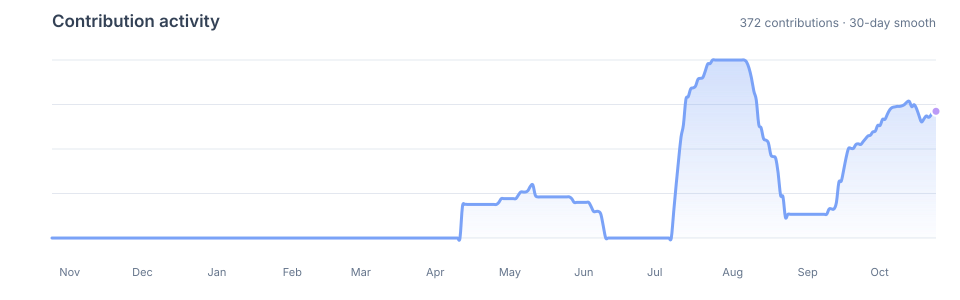

 

# Hi 👋, I'm Yosab Fouad

### Software Engineering Student | Aspiring React Native Developer

**Code • Learn • Build • Improve 🚀**

---

## 👨‍💻 About Me

- 📍 Based in Egypt.
- 🎓 Software Engineering student.
- 📱 Interested in building cross-platform mobile applications with **React Native**.
- ⚙️ Exploring backend engineering with **Node.js, Express.js, NestJS, and MongoDB**.
- 🧠 Strengthening my knowledge of data structures, algorithms, and software architecture.
- 🛠️ I enjoy learning by building projects, solving problems, and experimenting with new tools.
- 🤝 Open to collaboration, knowledge sharing, and opportunities to grow as a software engineer.

My goal is to build reliable, maintainable, and user-focused software while continuously improving my engineering skills.

---

## 🧰 Tech Stack

### Programming Languages

  
  
  
  
  
  
  

### Frontend Development

  
  
  

### Mobile Development

  

### Backend Development & Databases

  
  
  
  
  
  

### Computer Science & Engineering

  
  
  
  

### Tools & Environment

  
  
  
  
  
  

---

## 🚀 Projects & Technical Work

### 📝 Blog API — NestJS & MongoDB

A backend application focused on modular architecture, REST API development, and database integration.

- **Technologies:** TypeScript, NestJS, MongoDB, Mongoose
- **Focus:** Application modules, data modeling, and backend architecture.

### ⚙️ Backend Development Assignments

Practical backend exercises involving Node.js application development, HTTP servers, file system operations, and API implementation.

- **Technologies:** Node.js, Express.js, MongoDB, Mongoose
- **Focus:** Routing, middleware, controllers, validation, error handling, and database operations.

### 📚 Git & GitHub Documentation

A dedicated repository for documenting Git and GitHub concepts, commands, version control workflows, and development practices.

---

## 📊 GitHub Analytics

### 🔥 Contribution Streak

---

## 📈 Contribution Activity

---

## 🎯 Current Focus

- 📱 Improving my React and React Native development skills.
- ⚙️ Building backend applications with Node.js and NestJS.
- 🗄️ Practicing database design and REST API development.
- 🧠 Strengthening problem-solving and computer science fundamentals.
- 🏗️ Learning software architecture, testing, and maintainable coding practices.
- 🐳 Exploring Docker and modern development workflows.

---

## 🤝 Let's Connect

I'm always happy to connect with fellow developers, collaborate on projects, and exchange ideas.

### ⭐ Thanks for visiting my profile!

*Keep learning. Keep building. Keep improving.* 🚀

